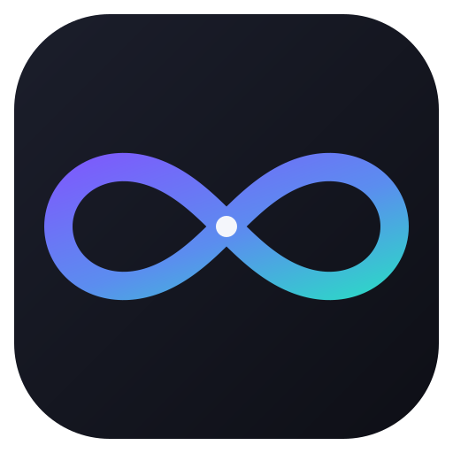

<p align="center">
  
</p>

<h1 align="center">KubePilot</h1>

<p align="center">
  An AI assistant for understanding and troubleshooting Kubernetes workloads.
</p>

<p align="center">
  <a href="#try-the-demo">Try the demo</a> ·
  <a href="#develop-locally">Develop locally</a> ·
  <a href="docs/runbooks/">Browse runbooks</a>
</p>

---

## What is KubePilot?

KubePilot gives Kubernetes operators one place to ask questions, inspect cluster
evidence, find relevant runbooks, diagnose deployments, and create incident
reports.

It is designed to support human decisions, not replace them. Answers are built
from observable signals and documented runbooks so an operator can review the
evidence behind a recommendation.

## Try the demo

### Requirements

- Git
- Docker Engine with the Docker Compose plugin

Check that Docker is installed and running:

```bash
docker --version
docker compose version
```

On a new computer, install Docker Desktop or Docker Engine first. Docker must
be running before you start KubePilot.

### First-time setup

Clone the repository and move into it:

```bash
git clone https://github.com/AryanSharma9917/kubepilot.git
cd kubepilot
```

You do not need to create a Python virtual environment for the Docker demo.
Docker installs the application dependencies while it builds the images.

### Start KubePilot

From the repository root, run this on the first launch:

```bash
docker compose up -d --build
```

The `--build` option creates the KubePilot images locally and downloads the
required base images. The first launch can take a few minutes. Later launches
can use `docker compose up -d` unless the source or Docker configuration changed.

Then open [http://127.0.0.1:3000](http://127.0.0.1:3000).

The demo includes a web console, FastAPI backend, Kubernetes inspection service,
Postgres, and predictable unhealthy workloads. No cloud account or Kubernetes
cluster is required for the default demo.

### Start an investigation

The console opens on **Overview**. Choose **Investigate** beside a workload needing
attention to open its diagnosis, evidence, and suggested checks. Use **Workloads**
to enter a namespace and deployment manually, and **Incidents** to review the
reports you explicitly create from an investigation, then copy or export them.

The Overview identifies the data source. Native fixture mode uses sample workloads.
The default Docker demo uses an inspection service configured with fixtures; service
mode alone does not establish that a real cluster is connected.

**Help & tools** contains general chat, getting started guidance, and developer
activity. Runtime settings and capability information are under **Developer details**
on Overview. Recommendations are guidance; review commands before running them.

### Ask a question

Try any of these prompts in the console:

```text
Show unhealthy workloads
Why is checkout failing?
Why is email-worker pending?
How do I troubleshoot ImagePullBackOff?
Create an incident report for deployment checkout
```

### Check that it is working

```bash
./scripts/web-smoke.sh
```

Useful links:

- Web console: [http://127.0.0.1:3000](http://127.0.0.1:3000)
- API documentation: [http://127.0.0.1:8000/docs](http://127.0.0.1:8000/docs)
- API health: [http://127.0.0.1:8000/healthz](http://127.0.0.1:8000/healthz)

Stop the demo with:

```bash
docker compose down
```

For a guided walkthrough, run `./scripts/demo.sh`. To try the same workflow on
a local kind cluster, run `./scripts/kind-demo.sh`.

## Guided demo walkthrough

You do not need to invent a chat prompt to begin. On **Overview**, select
**Investigate** beside a workload, then follow its observed problem, failure signals,
pod/event/log evidence, explained checks, and verification guidance.

| Demo workload | What to investigate |
| --- | --- |
| `payments/checkout` | Crashing containers, image pull failures, and missing configuration |
| `platform/metrics-scraper` | Readiness probe failures |
| `notifications/email-worker` | Pending pods and scheduling constraints |

Select **Ask about this workload** to attach its namespace and deployment to chat.
Try **Explain this failure**, or clear the context for a general runbook question.
Source excerpts appear with answers when returned; runbooks are guidance, not proof
of a root cause. Chat does not provide conversation memory.

Back in **Workloads**, select **Create incident report** to save a fresh evidence
snapshot. Diagnosis alone does not save a report. Under **Incidents**, select a saved
report, copy its stakeholder update, or download Markdown. Export preserves the saved
report ID and does not generate another artifact. The list shows up to 100 recent
reports. Native in-memory reports reset with the API; Compose uses Postgres.

Demo workloads remain unhealthy by design. KubePilot does not execute the displayed
commands or repair fixture data. Review commands before running them on a real cluster.
For a missing deployment, check its name and namespace. If data is unavailable,
check the API and select **Refresh**. If the clipboard is blocked, download Markdown
or expand its preview and copy manually. **Help & tools → Getting started** repeats
this walkthrough inside the app.

For frontend checks and browser coverage, see [web/README.md](web/README.md).

## What KubePilot can do

- Answer Kubernetes operations questions through a chat interface
- Find relevant troubleshooting guidance in Markdown runbooks
- Inspect workload health, pods, events, and logs
- Diagnose common failures such as `CrashLoopBackOff`, `ImagePullBackOff`,
  readiness probe failures, and pending pods
- Generate JSON or Markdown incident reports with evidence and next actions
- Expose metrics, traces, and audit events for operational visibility
- Run with predictable fixtures locally or connect to a real Kubernetes cluster

## How it works

```text
                    KUBEPILOT
                       |
        +--------------+--------------+
        |                             |
     Frontend                     Backend/API
        |                             |
     HTML/CSS/JS                    FastAPI
                                      |
                         +------------+------------+
                         |            |            |
                       Agent         RAG       Kubernetes
                         |            |            |
                       LLM*       Retrieval    K8s API
                         |            |            |
                         +------------+------------+
                                      |
                             Infrastructure
                                      |
              +----------------------+----------------+
              |                       |                |
           Docker                 Kubernetes          GitOps
              |                       |                |
         Containers              Helm/ArgoCD       GitHub Actions
                                      |
                             Observability
                                      |
                         Prometheus/Grafana/OpenTelemetry
```

\* The default local demo uses deterministic answer synthesis. A self-hosted
HTTP LLM can be configured separately when needed.

The main building blocks are:

- `web/` - browser-based KubePilot console
- `services/api/` - FastAPI routes, authentication, audit, metrics, and tracing
- `agent/` - intent routing, workflow orchestration, tools, and answer synthesis
- `rag/` - runbook loading, chunking, indexing, retrieval, and evaluation
- `services/k8s-tool/` - Go service for Kubernetes inspection

## Develop locally

Python 3.11 or newer is required.

```bash
python3 -m venv .venv
source .venv/bin/activate
python -m pip install -e ".[dev]"
uvicorn kubepilot_api.main:app --reload
```

To use the web console without Docker, keep the API running and start this in a
second terminal from the repository root (Node.js 20+):

```bash
node web/dev-server.cjs
```

The native UI uses port 3000 and proxies the API on port 8000. Override these with
`KUBEPILOT_WEB_PORT` and `KUBEPILOT_API_URL`. It binds to loopback for local development.
No npm installation is required to run this server. Docker Compose remains the
full demo option with Postgres and the Go inspection service.

The API is then available at [http://127.0.0.1:8000](http://127.0.0.1:8000).
The interactive API reference is at [http://127.0.0.1:8000/docs](http://127.0.0.1:8000/docs).

Run the checks with:

```bash
pytest
ruff check .
```

Optional dependency groups are available for real Kubernetes access, vector
retrieval, LangGraph, and OpenTelemetry. Install everything with:

```bash
python -m pip install -e ".[all]"
```

## Repository guide

| Path | Purpose |
| --- | --- |
| `docs/runbooks/` | Troubleshooting guidance used by retrieval |
| `demo/kubernetes/` | Intentionally unhealthy demo workloads |
| `helm/kubepilot/` | Helm chart for Kubernetes deployment |
| `gitops/argocd/` | Argo CD application manifests |
| `monitoring/` | Prometheus alerts and Grafana dashboard |
| `scripts/` | Demo and smoke-test workflows |
| `tests/` | API, agent, RAG, and Kubernetes tool tests |

## Deploying beyond the demo

The repository includes starter assets for Helm, Argo CD, Prometheus, and
Grafana. Before connecting KubePilot to a real cluster, review:

- [Real-cluster readiness](docs/real-cluster-readiness.md)
- [Production checklist](docs/production-checklist.md)
- [Security guidance](SECURITY.md)
- [GitOps setup](docs/gitops.md)

The default Compose setup uses Postgres for incident report artifacts. Without a
database URL, the API uses an in-memory store, which is useful for tests and
lightweight development.

## Project status

KubePilot is an active portfolio and experimentation project. The local fixture
demo is the easiest way to explore it. Production deployment, real-cluster
permissions, authentication, and observability still require environment-specific
configuration and review.

## License

See the repository for current licensing information.
